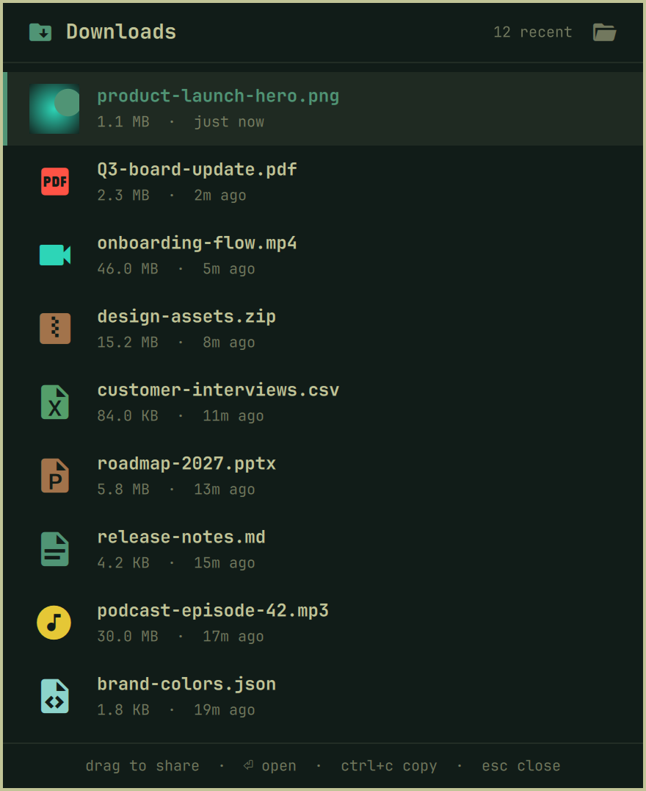

# Downloads for Omarchy

A themed popup of your newest downloads for the [Omarchy](https://omarchy.org) shell. Press a key, drag a file straight into Slack, a browser, Claude, or any other app, and the popup gets out of the way. It's the Downloads stack from the macOS dock, without a dock.

<p align="center"></p>

- The 15 newest files in your Downloads folder, newest first
- A Nerd Font icon per file type, colored from your theme's palette, and real thumbnails for images
- Size and age for every file ("2.3 MB · 5m ago")
- A real Wayland drag (`text/uri-list`), so any app that accepts dropped files takes the drop. The popup fades while you drag and closes once the file lands
- Follows your Omarchy theme, font, corner radius, and menu styling, and switches live when the theme does
- Skips hidden files and unfinished browser downloads (`.part`, `.crdownload`)

## Install

```bash
omarchy plugin add https://github.com/KirklandGee/omarchy-downloads.git --enable
```

Then bind a key in `~/.config/hypr/bindings.lua`:

```lua
o.bind("SUPER + ALT + D", "Downloads", "omarchy-shell shell toggle kirklandgee.downloads")
```

Hyprland reloads on save. Press the same key again to close the popup.

## Use

| Action            | What it does                              |
|-------------------|-------------------------------------------|
| Drag a row        | Drop the file into any app                |
| Click / `Enter`   | Open the file                             |
| `↑` `↓` / `k` `j` | Move the selection                        |
| `Ctrl+C`          | Copy the selected file to the clipboard   |
| Folder button     | Open the Downloads folder                 |
| `Esc`             | Close                                     |

## Theming

The popup uses the same `[menu]` surface tokens as Omarchy's built-in emoji picker, so a theme that styles the menu in its `shell.toml` styles this popup too. File-type icons take their colors from the theme's `colors.toml` (`red` for PDFs, `magenta` for images, `orange` for archives, and so on).

## Update and remove

```bash
omarchy plugin update kirklandgee.downloads
omarchy plugin remove kirklandgee.downloads
```

## License

[MIT](LICENSE)
